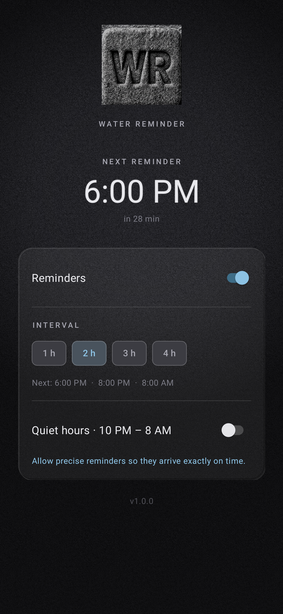

# Water Reminder — v1.0.0

A tiny Android app with exactly one job: **send a water reminder notification every two hours.**

There is no intake log, no add/subtract buttons, no counters, no charts. The app
never asks how much you drank — it just nudges you to drink.

## Download

Grab the signed APK from the assets of this release and install it (you may need
to allow "install from unknown sources" for your file manager).

## What it does

- Fires a single notification every **2 hours** (1 h / 3 h / 4 h also available)
- Reminder slots are aligned to your local wall clock, so they always land on
  :00 — 08:00, 10:00, 12:00 and so on
- Uses an exact alarm, so reminders still arrive in Doze and survive reboots
- Optional quiet hours (10 PM – 8 AM) — slots inside the window are skipped
  entirely rather than queued up
- Re-arms automatically after a reboot, an app update or a time zone change

## The look

The interface is built from felt and sweatshirt fleece: a tiled wool texture
with a soft vignette, a debossed panel, and the `WR` mark pressed into a felt
patch.

| Mark | Home screen |
|---|---|
|  |  |

*The screenshot is rendered off-device by `AppScreenshotTest` on every CI run.*

## Building from source

```bash
cd android
gradle :app:assembleRelease      # signed APK -> app/build/outputs/apk/release/
gradle :app:testDebugUnitTest    # scheduling unit tests
```

Signing material is supplied through environment variables so no key is ever
committed:

```bash
export ANDROID_KEYSTORE_FILE=/absolute/path/to/release.p12
export ANDROID_KEYSTORE_PASSWORD=...
export ANDROID_KEY_ALIAS=...
export ANDROID_KEY_PASSWORD=...
```

Assets are generated from the master logo with ImageMagick:

```bash
./tools/make-assets.sh
```

## Stack

Kotlin · Android SDK 34 (min 24) · AGP 8.5.2 · Material 3 · `AlarmManager`
exact alarms · SharedPreferences · ViewBinding. No analytics, no network calls,
no account, no backend.
